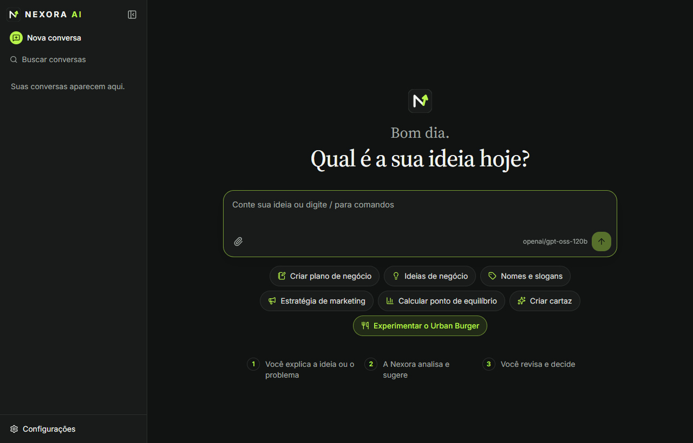
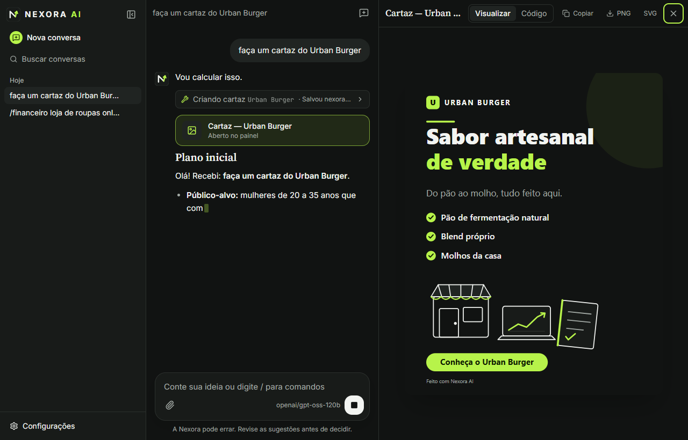

# Nexora AI

> **Da ideia ao negócio, com inteligência.**

Assistente de inteligência artificial para **empreendedores e pequenos negócios**. A Nexora ajuda a criar ideias de negócio, planos, público-alvo, nomes e slogans, estratégias de marketing, textos para redes sociais, contas financeiras, metas e melhorias.

> 🎓 Projeto escolar (conceito). A *Nexora Technologies* é uma empresa fictícia.

Funciona em 3 passos:

1. **Você explica** a sua ideia.
2. **A Nexora analisa** e sugere.
3. **Você revisa e decide.**

Uma mesma base de código alimenta **duas interfaces**:

| CLI (terminal, estilo Claude Code) | Web (estilo claude.ai) |
|---|---|
| `nexora` | `nexora web` → http://localhost:4173 |





---

## Sumário

- [Instalação](#instalação)
- [Chave da Groq](#chave-da-groq)
- [Usando o CLI](#usando-o-cli)
- [Usando a web](#usando-a-web)
- [Comandos de negócio](#comandos-de-negócio)
- [Ferramentas da IA](#ferramentas-da-ia)
- [Estrutura do projeto](#estrutura-do-projeto)
- [Testes](#testes)
- [Limitações](#limitações)

## Instalação

Requisitos: **Node.js 20+** e **pnpm**.

```bash
git clone https://github.com/stumdev/nexora-ai.git
cd nexora-ai

npm install -g pnpm          # se ainda não tiver
pnpm install                 # dependências
pnpm build                   # compila web e CLI
cd cli && npm link && cd ..  # cria o comando "nexora"
```

Sem o `npm link`, rode `pnpm nexora` (CLI) ou `pnpm web` (web) dentro da pasta do projeto.

## Chave da Groq

A IA usa a **API da Groq**, que tem plano gratuito.

1. Crie uma conta em https://console.groq.com/keys.
2. Clique em **Create API Key** e copie a chave (começa com `gsk_`).
3. Configure de um destes jeitos:
   - rode `nexora` e cole a chave quando pedir (fica em `~/.nexora/config.json`);
   - na web, abra **Configurações** e cole a chave (há o botão *Testar conexão*);
   - ou defina a variável `GROQ_API_KEY` (tem prioridade sobre as outras):
     - PowerShell: `setx GROQ_API_KEY "gsk_sua_chave"` (abra um terminal novo depois)
     - Linux/macOS: `export GROQ_API_KEY="gsk_sua_chave"`

A chave fica só no seu computador. Não há telemetria.

### Modelos e fallback

Modelo padrão: `openai/gpt-oss-120b`. Se o limite gratuito acabar (erro 429) ou o modelo cair, a Nexora tenta o próximo da lista:

`openai/gpt-oss-120b` → `openai/gpt-oss-20b` → `llama-3.3-70b-versatile` → `llama-3.1-8b-instant`

A lista é editável em `~/.nexora/config.json`:

```json
{
  "model": "openai/gpt-oss-120b",
  "models": ["openai/gpt-oss-120b", "openai/gpt-oss-20b", "llama-3.3-70b-versatile"]
}
```

Os modelos gratuitos mudam com frequência. Veja a lista atual em https://console.groq.com/docs/models.

## Usando o CLI

```bash
nexora                                          # abre o chat
nexora "quero abrir uma loja de roupas online"  # abre já com uma pergunta
nexora -p "quero abrir uma loja de roupas"      # responde e sai
nexora -c                                       # continua a última conversa
nexora -m openai/gpt-oss-20b                    # escolhe o modelo
nexora web                                      # sobe a versão web
```

No modo `-p`, ações que alteram arquivos (`Write`, `Edit`, `Bash`) são negadas por segurança. Use `--yes` para permitir e `--json` para saída em JSON. Para não limpar o terminal ao abrir, defina `NEXORA_NO_CLEAR=1`.

| Tecla | Ação |
|---|---|
| `Enter` | envia |
| `\` + `Enter` ou `Alt+Enter` | nova linha |
| `↑` / `↓` | histórico de mensagens |
| `Tab` | completa `/comandos` |
| `Esc` | interrompe a resposta / limpa o campo |
| `Ctrl+C` | interrompe; duas vezes seguidas sai |

Comandos do chat: `/help`, `/clear`, `/model [nome]`, `/resume`, `/export [arquivo.md]`, `/key`, `/exit`.

## Usando a web

```bash
nexora web                       # http://localhost:4173
nexora web --port 4174 --no-open
```

- O servidor aceita conexões **apenas deste computador** (localhost).
- Sidebar com conversas (Hoje, Ontem, Anteriores), busca, renomear, exportar e excluir.
- Composer: `Enter` envia, `Shift+Enter` quebra linha, `/` abre o menu de comandos, 📎 anexa `.txt`/`.csv`.
- Planos, tabelas e cartazes abrem num **painel lateral** (Visualizar / Código, copiar, baixar; cartaz em PNG ou SVG).
- Configurações: chave da Groq, modelo, seu nome e tema claro/escuro.
- Atalhos: `Ctrl+Shift+O` nova conversa, `Ctrl+B` sidebar, `Esc` para a resposta.

As conversas ficam em `~/.nexora/nexora.db` (SQLite) e são **compartilhadas** entre CLI e web.

## Comandos de negócio

Funcionam no CLI e na web. Cada um é um prompt em Markdown na pasta [`skills/`](skills).

| Comando | O que faz |
|---|---|
| `/ideia [tema]` | 5 a 8 ideias de negócio com investimento, prós e contras |
| `/plano [negócio]` | plano de negócio enxuto, com contas feitas pela ferramenta Finance |
| `/publico [negócio]` | personas, dores, onde encontrar e linguagem |
| `/nomes [negócio]` | nomes e slogans (lembra de checar INPI e domínio) |
| `/marketing [negócio]` | estratégia por canal e calendário de 4 semanas |
| `/post [assunto]` | textos para Instagram, WhatsApp e anúncios (A/B) |
| `/financeiro [dados]` | ponto de equilíbrio, margem, preço, fluxo de caixa, payback |
| `/metas [objetivo]` | metas SMART com checkpoints semanais |
| `/melhorar [situação]` | diagnóstico e melhorias por impacto × esforço |
| `/comparar [A vs B]` | comparação com critérios ponderados |
| `/cartaz [marca]` | texto de divulgação + cartaz (SVG/HTML/PNG em `./nexora-docs/`) |
| `/demo` | exemplo **Urban Burger** (hamburgueria fictícia, R$ 10 mil, Instagram) |

**Comandos próprios:** salve um `.md` em `./.nexora/commands/` no mesmo formato dos arquivos de `skills/` (use `$ARGUMENTS` para o texto digitado depois do comando).

**Contexto do negócio:** crie um `NEXORA.md` na pasta onde roda a Nexora (nome, cidade, público, orçamento...). Ele é lido em toda conversa.

## Ferramentas da IA

A IA usa ferramentas de verdade, exibidas como blocos `● Nome(alvo)` no terminal e blocos recolhíveis na web:

`Read`, `Write`, `Edit`, `Bash`, `Glob`, `Grep`, `WebFetch`, `TodoWrite`, **`Finance`** (as contas são feitas em código, não "de cabeça") e **`Poster`** (cartaz grafite + verde-lima).

**Permissões:** antes de `Write`, `Edit` e `Bash`, a Nexora pergunta *Sim / Sim, não perguntar de novo nesta sessão / Não*, mostrando o diff ou o comando.

## Estrutura do projeto

```
core/     lógica compartilhada: agente, provider Groq, ferramentas, permissões, SQLite, skills
cli/      terminal (Ink + React)
server/   API local (Hono + SSE) que também serve a web
web/      interface web (React + Vite + Tailwind)
skills/   comandos de negócio em Markdown
e2e/      testes ponta a ponta (Playwright) e um servidor Groq falso
```

Stack: TypeScript, Node 20+, pnpm workspaces, Ink, Hono, React, Vite, Tailwind, better-sqlite3, Vitest, Playwright.

## Testes

```bash
pnpm test        # core (Finance, loop do agente, Edit, banco, skills) e CLI
pnpm typecheck   # checagem de tipos
pnpm e2e         # web no Edge/Chrome instalado, com Groq falso
```

Os testes não gastam a sua cota da Groq.

## Limitações

- A IA **pode errar** e não substitui contador, advogado ou outros profissionais. **A decisão final é sempre do empreendedor.**
- A Nexora não promete lucro nem resultados e não deve inventar dados de mercado: valores sem fonte aparecem como estimativa.
- O plano gratuito da Groq tem limites; quando acabam, a Nexora troca de modelo ou pede para esperar.

---

## Licença

Distribuído sob a licença [MIT](LICENSE).

---

*"A inteligência artificial não cria o empreendedor. Ela oferece ferramentas para que suas ideias possam ir mais longe."*
